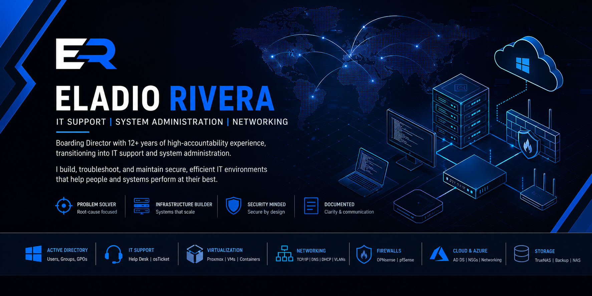

  

<h1 align="center">Eladio Rivera</h1>

  Systems & Infrastructure | Active Directory | Networking | Troubleshooting

---

## 🚀 About
Built and operated a multi-system lab environment supporting real users, designed under constraints such as ISP limitations, hardware inefficiency, and network instability.

12+ years managing high-accountability environments, now applying that same operational mindset to IT systems—focusing on troubleshooting, system reliability, and controlled deployment.

Work is centered on identifying failures, making decisions under constraints, and restoring system functionality across Windows, Azure, virtualization, and networked environments.

---

## 🛠 Core Skills
- Active Directory & user lifecycle management  
- Windows / Azure environments  
- Virtualization (Proxmox)  
- Networking (TCP/IP, DNS, DHCP, VLANs)  
- Firewall configuration (OPNsense / pfSense)  
- Help desk workflows & ticketing systems (osTicket)  
- Troubleshooting & system diagnostics  
- Technical documentation  

---

## 💻 Projects

### 🔹 Ethernet Wiring Practice Game (T568A & T568B)

👉 **[Play the Game](https://erivera3.github.io/ethernet-wiring-game/)** · **[View Source Code](https://github.com/erivera3/ethernet-wiring-game)**

An interactive study tool I created with AI assistance while preparing for CompTIA A+. Choose T568A or T568B, place all eight wires, and check your answer. Includes drag-and-drop, tap controls, and optional hints.

**Built with:** HTML, CSS, and JavaScript · Hosted on GitHub Pages.

<strong>How I memorize the wire order—and why this method helps</strong>

#### My method for remembering the wire order

I memorize the fixed wires first, then use the letter to choose the starting color.

1. **Brown at the end: pins 7–8.** White/brown first, then solid brown.
2. **Blue in the middle: pins 4–5.** Flip the usual stripe-first order: solid blue at 4, white/blue at 5.
3. **Check A or B, then fill pins 1–2.**
   - **B = Basketball = Orange:** white/orange at 1, solid orange at 2.
   - **A = Alien snot = Green:** white/green at 1, solid green at 2.
4. **Fill the remaining pins: 3 and 6.** Use the color left over—green for B, orange for A. White-striped wire at 3, solid wire at 6.

**My sequence: 7–8 → 4–5 → 1–2 → 3–6.**

The stripe comes first in each pair when read by pin number, except blue: **4 is solid, 5 is striped**.

Practice from an empty connector, check your answer, then shuffle and repeat. Switch between A and B once you can do each reliably.

#### Why this memory method helps

The routine reduces eight wire positions to four pairs and a consistent sequence. It uses established learning principles; it is a memory aid, not a guarantee.

- **Fixed anchors:** Blue and brown stay in the same positions in both standards, reducing what you must work out each time.
- **Chunking:** Remember four pairs and a repeatable routine instead of eight disconnected facts.
- **Distinctive cues:** Basketball orange and alien-snot green connect each standard to a vivid image that can help you retrieve the starting color.
- **A clear exception:** Stripe first within each pair by pin number, except blue: solid at 4, stripe at 5.
- **Retrieval practice and feedback:** Close the guide, build from empty pins, check your answer, and correct mistakes. Recalling the order gives you practice that simply looking at the answer does not.
- **Spacing and mixing:** Return tomorrow, then a few days later. Once you can do each standard, alternate A and B to practice choosing the right order.

**One correct attempt is not mastery.** Aim to wire both standards correctly from memory across several sessions. With practice, recall can become faster and require less conscious effort. These are learning principles, not claims that this particular game has been experimentally validated or that a specific brain region explains its effects.

---

### 🔹 Homelab Infrastructure (System Administration & Networking)
👉 **[View Project](https://github.com/erivera3/homelab-infrastructure)**  

**Context:**  
Environment supporting ~13 real systems, built under hardware, network, and ISP constraints.

**Key Problems Solved:**  
- ISP router restriction preventing full network control  
- High power consumption and thermal inefficiency from legacy hardware  
- Fragmented storage and lack of centralized data management  
- Flat network design with limited traffic control  

**Decisions & Actions:**  
- Introduced OpenWRT and OPNsense to regain routing and firewall control  
- Consolidated storage using TrueNAS with ZFS  
- Redesigned infrastructure using smaller, energy-efficient hardware  
- Reimaged and deployed 13 systems for real user environments  

**Result:**  
- Stable multi-system environment with controlled networking and centralized storage  
- Reduced power usage, heat, and operational noise  
- Real-world troubleshooting across DNS, AD, networking, and deployment  
- Environment actively used and maintained, not simulated  

---

### 🔹 Help Desk & Ticketing Systems (osTicket)

**Projects:**  
[Deployment in Azure](https://github.com/erivera3/osticket-prereqs/)  
[Configuration & Setup](https://github.com/erivera3/post-install-config)  
[Ticket Lifecycle Examples](https://github.com/erivera3/ticket-lifecycle)

**Context:**  
Simulated support environment to understand how ticketing systems behave under different configurations and access constraints.

**Key Problems Solved:**  
- Application deployment blocked by misconfigured dependencies  
- Lack of structured ticket routing and ownership  
- Limited agent permissions preventing escalation  

**Decisions & Actions:**  
- Diagnosed and resolved IIS, PHP, and MySQL integration issues  
- Structured help desk using roles, departments, teams, and SLA policies  
- Simulated restricted access scenarios requiring escalation and admin intervention  

**Result:**  
- Fully functional ticketing system with controlled access and workflow structure  
- Demonstrated understanding of how configuration impacts system behavior  
- Experience troubleshooting multi-layer application environments  

---

### 🔹 Azure & Active Directory

**Projects:**  
[Active Directory Deployment](https://github.com/erivera3/configure-ad/)  
[Network Security & Traffic Inspection](https://github.com/erivera3/azure-network-protocols)

**Context:**  
Cloud-based environment to analyze system communication, identity management, and network behavior.

**Key Problems Solved:**  
- Domain join failures due to DNS misconfiguration  
- Network communication issues between virtual machines  
- Lack of visibility into how traffic behaves at the protocol level  

**Decisions & Actions:**  
- Reconfigured DNS to align with domain controller requirements  
- Validated connectivity and network placement within Azure  
- Used Wireshark to analyze real traffic across ICMP, DNS, DHCP, SSH, and RDP  
- Applied and tested NSG rules to control traffic flow  

**Result:**  
- Functional Active Directory environment with domain-joined systems  
- Improved troubleshooting through traffic-level validation  
- Clear understanding of how cloud security rules impact real communication  

---

## 🚨 Incident Response (Transferable Skills)

**Projects:**  
[Wildfire Incident Response System](https://github.com/erivera3/wildfire-incident-response-system/)  
Earthquake Response Protocol *(coming soon)*  
Campus Security Intruder Response *(coming soon)*

**Context:**  
Managed a real-world emergency involving 100+ individuals under uncertain and rapidly changing conditions.

**Key Problems Solved:**  
- Unclear threat progression with limited visibility  
- Need for immediate decision-making without external direction  
- Risk of delayed response under pressure  

**Decisions & Actions:**  
- Established predefined evacuation triggers to eliminate hesitation  
- Implemented continuous monitoring and escalation protocols  
- Reduced system load (population) to improve control and response speed  

**Result:**  
- Maintained full operational control with no injuries or incidents  
- Demonstrated structured response under pressure  
- Direct alignment with incident response, escalation workflows, and operational reliability in IT environments  

---

## 📘 Certifications

- CompTIA A+ (in progress)
- [Google IT Support Certificate - Google](https://www.coursera.org/account/accomplishments/specialization/D98LZJUS7750)
- [Technical Support Fundamentals – Google](https://www.coursera.org/account/accomplishments/records/YPQ25WXG5M3K)  
- [The Bits and Bytes of Computer Networking – Google](https://www.coursera.org/account/accomplishments/verify/640EJGQWAFQD)
- [Operating Systems and You: Becoming a Power User – Google](https://www.coursera.org/account/accomplishments/records/N7WMCW2PPOQT)
- [Hands-on Introduction to Linux Commands and Shell Scripting – IBM](https://www.coursera.org/account/accomplishments/records/N7WMCW2PPOQT)
 

---

## 🎯 Current Focus
- VLAN segmentation & network design  
- Firewall deployment (OPNsense)  
- Active Directory expansion  
- Infrastructure documentation  

---

## 🤝 Connect
- [LinkedIn](https://www.linkedin.com/in/eladiorivera/)  
- [GitHub](https://github.com/erivera3)  
